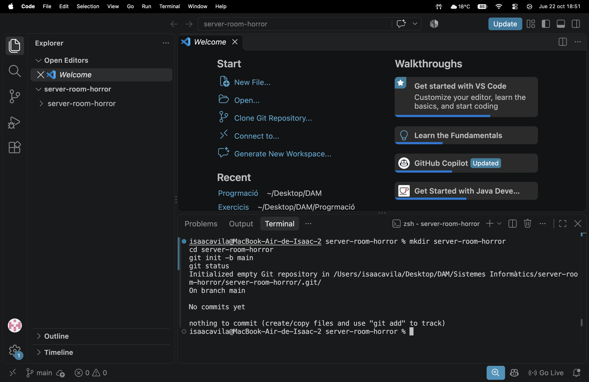
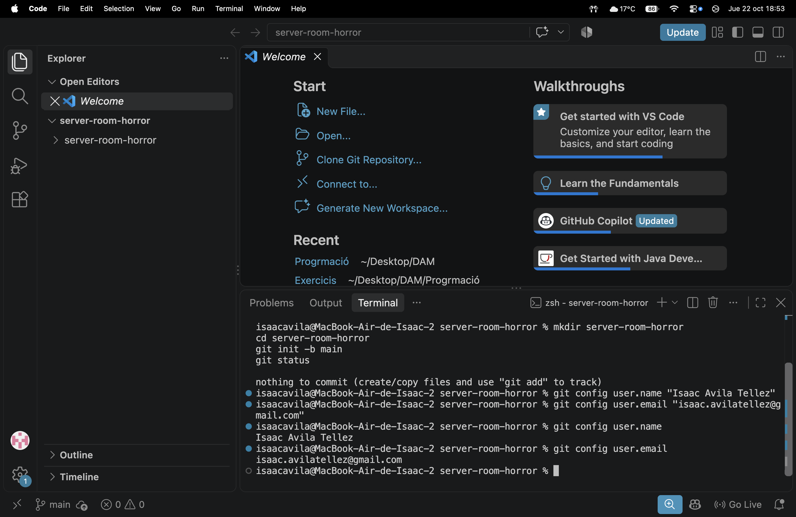

# Bloc 1: Invocació del Repositori i Línia Base

## Acció 3.1 — Creació del repositori

### Explicació tècnica
He creat la carpeta del projecte i he inicialitzat un repositori Git
local amb la branca principal main.

### Comandaments executats
```bash
mkdir server-room-horror
cd server-room-horror
git init -b main
git status
```

### Captura

