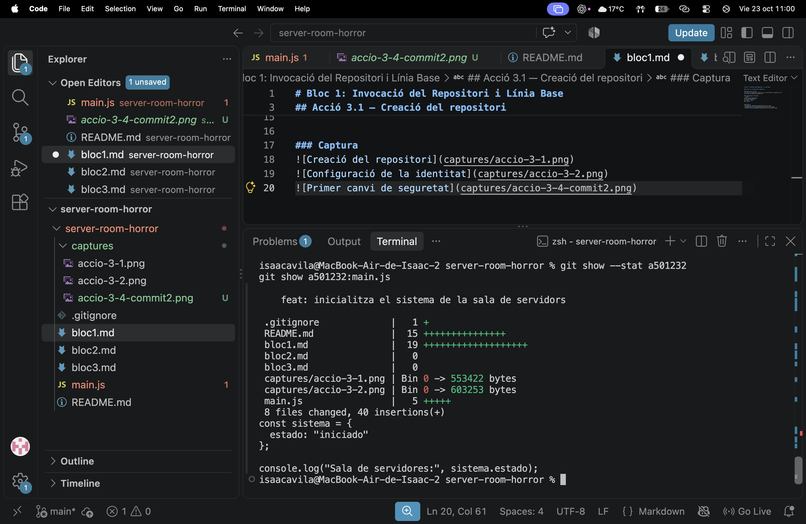
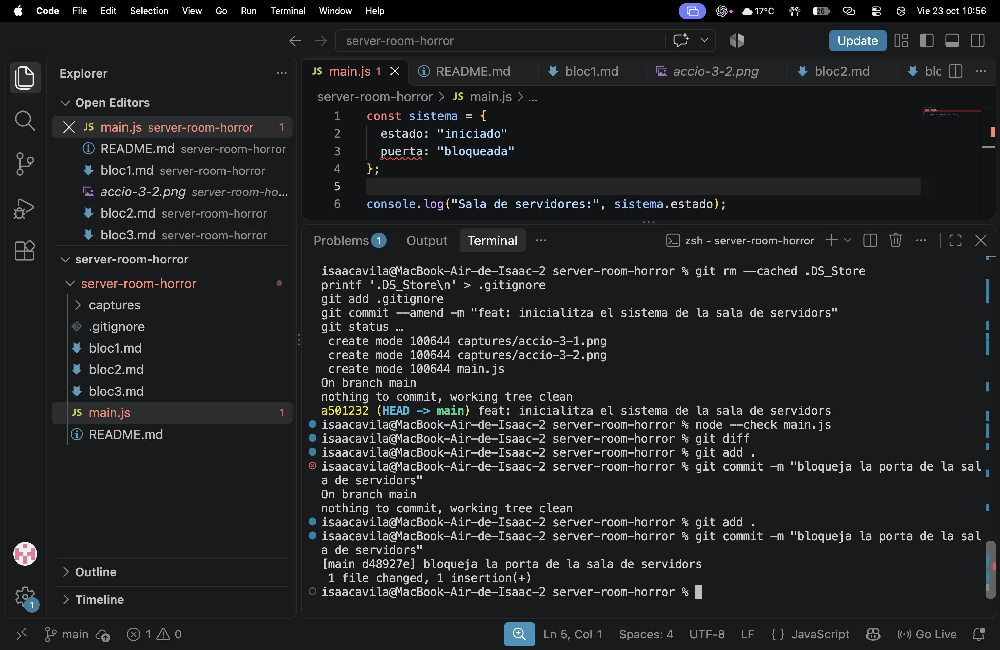
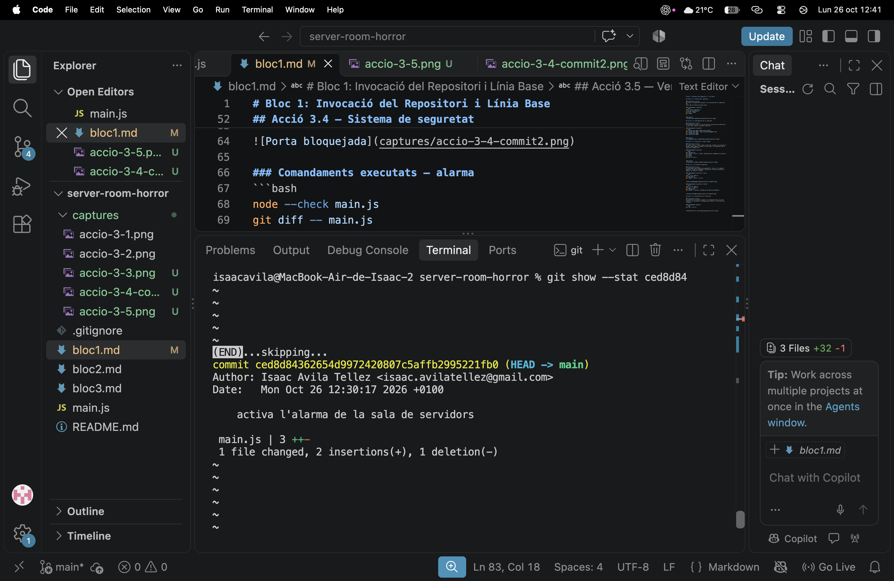
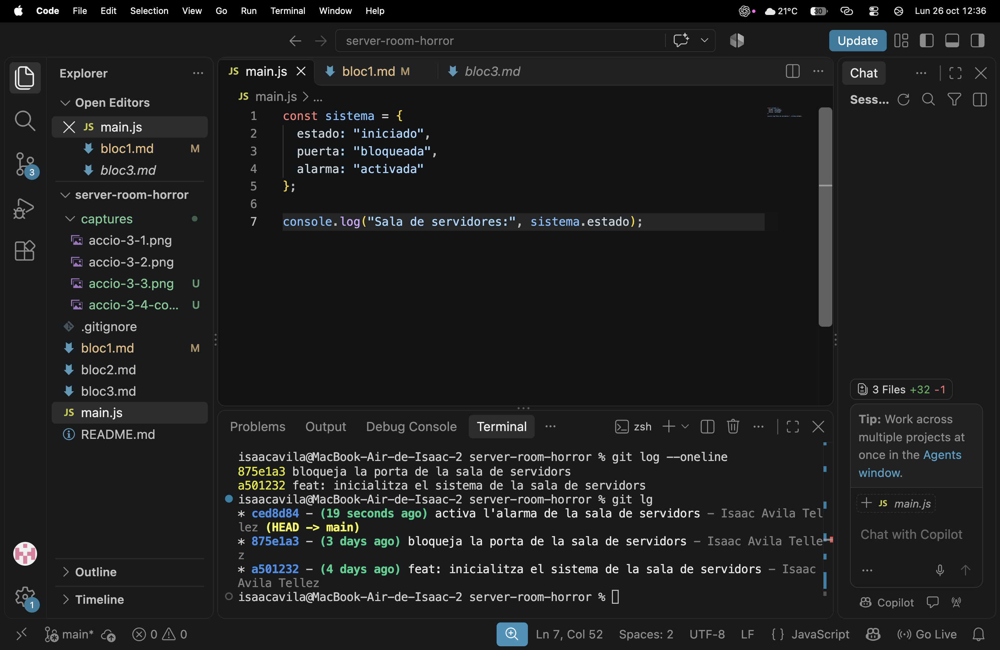

# Bloc 1: Invocació del Repositori i Línia Base

## Acció 3.1 — Creació del repositori

### Explicació tècnica
He creat la carpeta del projecte i he inicialitzat un repositori Git
local amb la branca principal main.

### Comandaments executats
```bash
mkdir server-room-horror
cd server-room-horror
git init -b main
git status
```

### Captura


## Acció 3.2 — Configuració de la identitat

### Explicació tècnica
He configurat el nom i el correu que Git utilitza per identificar l'autor dels commits en aquest repositori.

### Comandaments executats
```bash
git config user.name "Isaac Avila Tellez"
git config user.email "isaac.avilatellez@gmail.com"
git config user.name
git config user.email
```

### Captura


## Acció 3.3 — Codi base i primer commit

### Explicació tècnica
He creat `main.js` amb l'estat inicial del sistema. He corregit el primer commit perquè inclogui el codi base i he comprovat que el repositori quedava net.

### Comandaments executats
```bash
git add main.js
git commit --amend -m "feat: inicialitza el sistema de la sala de servidors"
git status
git log --oneline
```

### Captura


## Acció 3.4 — Sistema de seguretat

### Explicació tècnica
He incorporat dues mesures de seguretat a `main.js` en commits separats. Primer he bloquejat la porta de la sala de servidors i després he activat l'alarma.

### Comandaments executats — porta
```bash
node --check main.js
git add main.js
git commit --amend --no-edit
```



### Comandaments executats — alarma
```bash
node --check main.js
git diff -- main.js
git add main.js
git commit -m "activa l'alarma de la sala de servidors"
```



## Acció 3.5 — Verificació de l'historial

### Explicació tècnica
He consultat l'historial resumit i he comprovat que hi ha tres commits: el codi base, el bloqueig de la porta i l'activació de l'alarma.

### Comandament executat
```bash
git log --oneline
```

