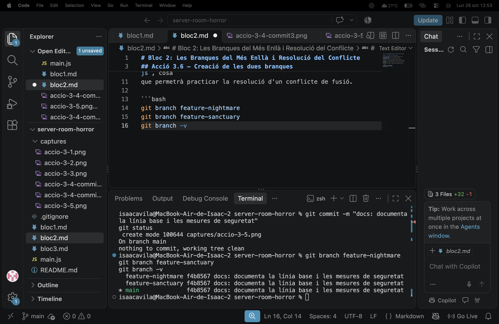
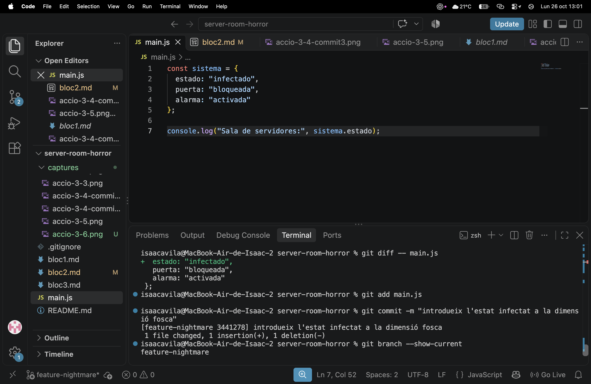

# Bloc 2: Les Branques del Més Enllà i Resolució del Conflicte

## Acció 3.6 — Creació de les dues branques

He creat dues branques a partir del mateix commit de `main`. `feature-nightmare`
representa la versió fosca i infectada del sistema; `feature-sanctuary`
representa la versió que protegeix la sala de servidors.

He escollit una base comuna perquè les dues versions evolucionin de manera
independent. Més endavant modificaran la mateixa línia de `main.js`, cosa
que permetrà practicar la resolució d'un conflicte de fusió.

```bash
git branch feature-nightmare
git branch feature-sanctuary
git branch -v
````

### Captura


## Acció 3.7 — Dimensió fosca

### Explicació tècnica
He canviat a `feature-nightmare` i he modificat l'estat del sistema
a `infectado`. El canvi queda aïllat en aquesta branca i no afecta
encara la versió de `main`.

### Comandaments executats
```bash
git switch feature-nightmare
node --check main.js
git diff -- main.js
git add main.js
git commit -m "feat: introdueix l'estat infectat a la dimensió fosca"
git branch --show-current
```

### Captura
