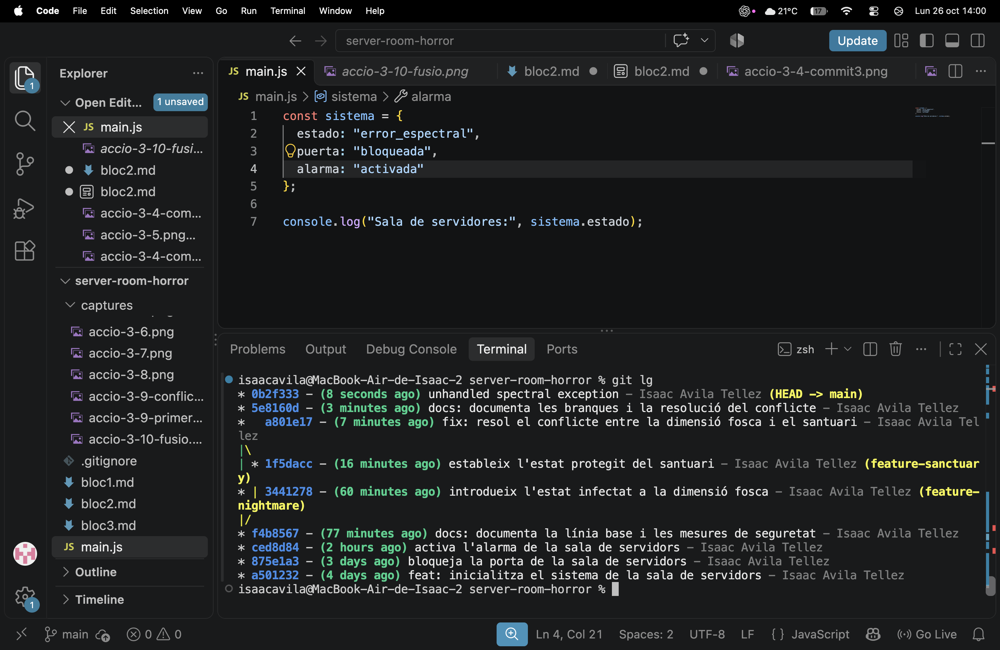
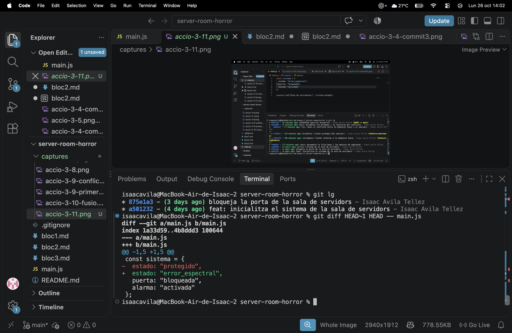
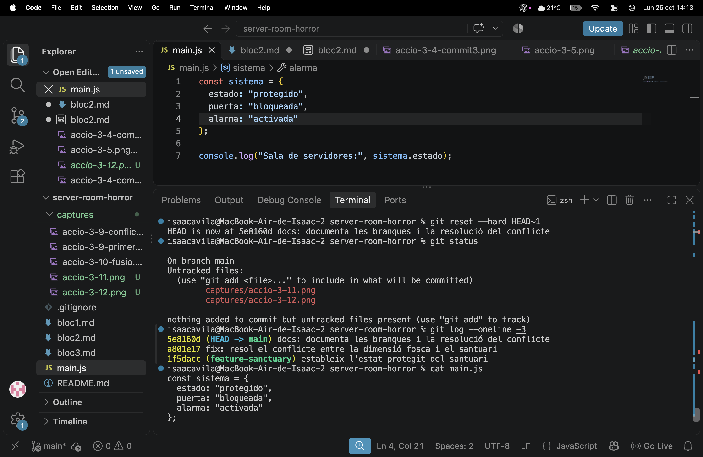
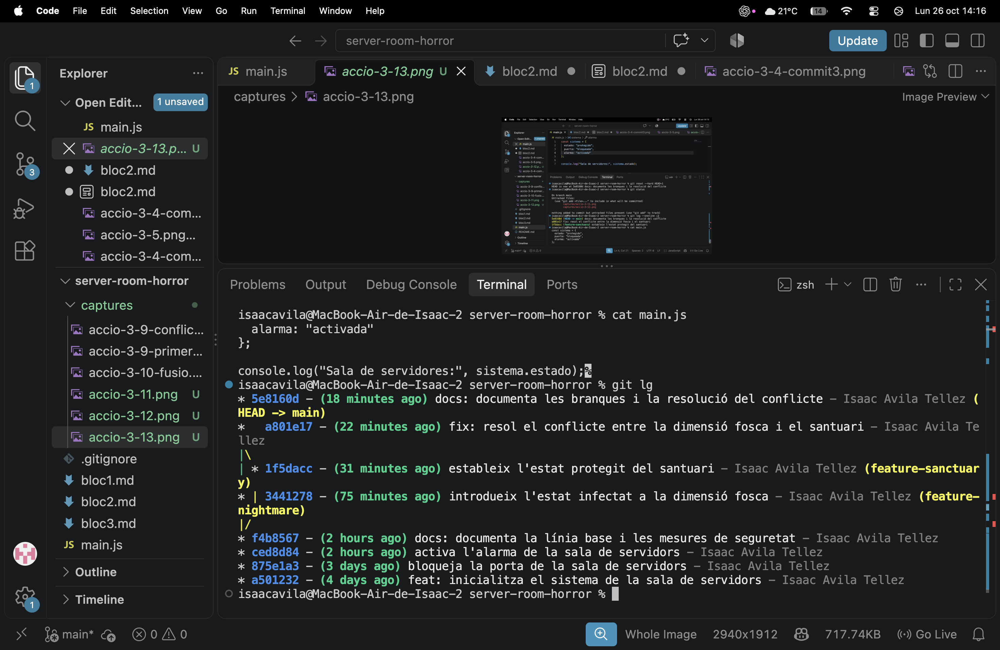
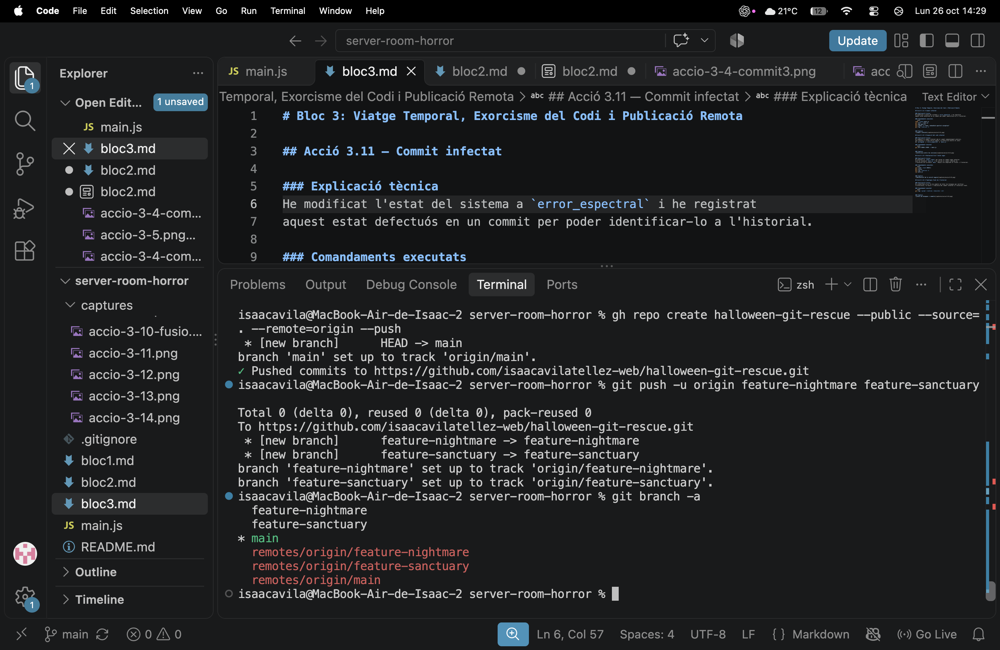

# Bloc 3: Viatge Temporal, Exorcisme del Codi i Publicació Remota

## Acció 3.11 — Commit infectat

### Explicació tècnica
He modificat l'estat del sistema a `error_espectral` i he registrat
aquest estat defectuós en un commit per poder identificar-lo a l'historial.

### Comandaments executats
```bash
node --check main.js
git diff -- main.js
git add main.js
git commit -m "feat: unhandled spectral exception"
git log --oneline -3
```

### Captura


## Acció 3.12 — Inspecció del codi infectat

### Explicació tècnica
He comparat el commit infectat amb el commit immediatament anterior,
que contenia l'última versió segura. La diferència mostra el canvi
de `protegido` a `error_espectral` a `main.js`.

### Comandament executat
```bash
git diff HEAD~1 HEAD -- main.js
```

### Captura


## Acció 3.13 — Restauració de l'estat segur

### Explicació tècnica
He executat un `reset --hard` per tornar al commit segur anterior.
Això ha restaurat `main.js` i ha retirat el commit infectat de
l'historial de la branca `main`. Després he comprovat el fitxer i l'historial.

### Comandaments executats
```bash
git reset --hard HEAD~1
git status
git log --oneline -3
cat main.js
```

### Captura


## Acció 3.14 — Topologia final de l'historial

### Explicació tècnica
He visualitzat el gràfic de commits de totes les branques per verificar
la bifurcació, la fusió i l'absència del commit infectat a l'historial final.

### Comandament executat
```bash
git log --graph --oneline --decorate --all
```

### Captura


## Acció 3.15 — Publicació a GitHub

### Explicació tècnica
He creat el repositori públic `halloween-git-rescue` a GitHub i
hi he publicat `main` i les dues branques de treball perquè es pugui
auditar l'historial complet.

### Comandaments executats
```bash
gh repo create halloween-git-rescue --public --source=. --remote=origin --push
git push -u origin feature-nightmare feature-sanctuary
git branch -a
```

### Repositori
https://github.com/isaacavilatellez-web/halloween-git-rescue

### Captura
